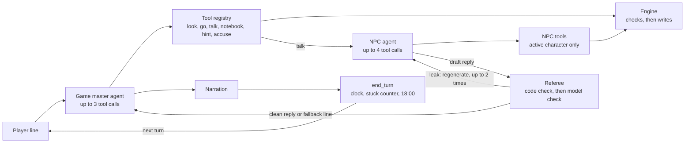

# Harbor Mystery

Harbor Mystery is a text detective game played in a terminal. You arrive in the fishing village of Saltmere, where the harbor's dredging winch was cut overnight. You walk between six places, question six villagers, collect clues in a notebook, and have one in-game day (06:00 to 18:00) to accuse the right person with evidence.

The game is a test bed. The point of the project is the architecture underneath it: a game master agent and NPC agents that act only through tools against a SQLite database, a referee that stops characters revealing facts they could not know, and a trace of every step. The agent loop is written by hand, with no agent framework. The full specification is [docs/BRIEF.md](docs/BRIEF.md).

## Setup and play

You need Python 3.11 or newer. From a clean checkout, in the repo root:

```
python3 -m venv .venv && .venv/bin/pip install -e '.[dev]' && .venv/bin/harbor play
```

Run `harbor` from the repo root: it reads the case from `cases/saltmere.json` and writes run files under `runs/` and `traces/`.

`harbor play` is offline. The game master, the characters and the referee's model check are deterministic scripted stand-ins (see [Limitations](#limitations)), so no API key or network is needed. Type one command per line:

| Command | What it does | Time |
| --- | --- | --- |
| `look` | Describe the place, who is here, the exits and any visible clue | 5 min |
| `go <place>` | Walk to a connected place | 10 min |
| `talk <person>: <what you say>` | Speak to someone here (`ask <person>: ...` also works) | 10 min |
| `notebook` | List the clues you have, with who told you and when | 0 |
| `hint` | The engine points you to a person and place worth a visit | 20 min |
| `accuse <person>: <motive> <clue ids>` | End the game, e.g. `accuse tom: money C3 C5` | 0 |
| `help`, `quit` | Show the commands; stop | 0 |

Names match by id or name, ignoring case ("fish market", "the salt cask", "ysolde").

## Commands

```
.venv/bin/harbor play                     # play offline; --seed N, --db PATH (':memory:' keeps nothing)
.venv/bin/harbor play < docs/demo-commands.txt   # play commands from a file; they are echoed
.venv/bin/harbor bot                      # watch the scripted bot solve the case
.venv/bin/harbor check-case               # load and validate cases/saltmere.json
.venv/bin/pytest                          # the offline test suite
.venv/bin/python traces/make_examples.py  # regenerate the saved example traces
```

## Architecture

The code is four layers, and only the bottom one may change game state.

| Layer | What it does | Code |
| --- | --- | --- |
| Interface | Reads one player line per turn and prints the narration | `cli.py` |
| Agents | The game master and NPC loops: call the model, run the tools it asks for, stop at a cap | `agents/`, `llm/`, `prompts/` |
| Tools | Plain Python functions with JSON schemas in one registry; the only door into the engine | `tools/`, `referee.py` |
| Engine | Rules, clock, trust, the event log and scoring, in one SQLite file per run | `engine/` |

Imports run one way (`cli` -> `agents` -> `tools` -> `engine`), and the engine never imports a model client. `tracing.py` cuts across all four. A test reads the source and fails if any of these rules is broken.

The rule behind the design is that the model proposes and the engine decides. An agent can only ask for something through a tool, and each tool checks the request in code before it changes anything. Tools return errors as values (`{"ok": false, "error": "..."}`) so the model can recover, and a tool call that fails is rolled back, so an error never leaves a half-made change.

### One turn

One typed line is one turn. The game master may call at most 3 tools per turn, and each NPC reply at most 4.



1. The game master gets the player's line and a short state summary (place, time, notebook clues) and chooses tools.
2. `look`, `go`, `notebook`, `hint` and `accuse` are validated and applied by the engine, which logs an event for each change.
3. `talk` checks the person is present, makes them the *active character* and starts the NPC agent, a separate model loop with its own prompt (persona and speech style) and its own four tools: `recall_knowledge`, `recall_conversation`, `reveal_clue` and `update_trust`.
4. The NPC's draft reply goes through the referee before `talk` returns it.
5. The game master narrates from what the tools returned this turn.
6. An engine step, `end_turn`, runs last: it counts turns without a new clue, arms a nudge after 8, and ends the game at 18:00.

### Knowledge isolation

No NPC tool takes a character argument. `talk(character)` sets the active character inside the engine, and `recall_knowledge()` and `reveal_clue(clue_id)` act on that character only, so an NPC model has no way to ask for another villager's facts. `reveal_clue` refuses a clue the character does not know or does not trust the player enough to share, and only `reveal_clue` can put a clue in the notebook. The case solution is read only by `engine/scoring.py` when the player accuses; no agent ever sees it.

### The referee

The referee checks every NPC draft before the player sees it. First a code check: each clue has keywords, and a draft that matches a clue this character has not revealed or confirmed in this conversation (and that the player did not just say) is a leak. If that passes, a cheap model call checks for stray facts the keywords miss. If the check model fails, the draft is treated as a leak. A rejected draft is regenerated with a note, up to 2 times, and after that the character says a fixed in-character fallback line from the case file. Whatever a rejected draft's tool calls wrote (a reveal, a trust step) is rolled back.

### Hints

Characters who do not know a clue but know who does say so ("Ask Bram. The lighthouse sees the water."); the engine picks the person and the model only phrases it. After 8 turns with no new clue, the engine arms the next unfound clue in a fixed order and the next suitable character brings it up unprompted. A nudge never bypasses trust: a guarded clue is nudged as a pointer to who knows it. `hint` names a person and place, never a clue's text.

### Tracing, the event log and replay

Every model call, tool call, referee check and agent run goes through one `tracing.span()` helper. Spans are written to the run's `spans` table and mirrored to `traces/<run_id>.jsonl`, with one trace per turn and parent links between spans. They use OpenTelemetry GenAI attribute names where they exist (`gen_ai.tool.name`, `gen_ai.agent.name`, ...) plus game attributes (`game.turn`, `game.npc`). A rejected draft keeps its raw text in a span with status `rejected`, so leaks can be counted later from the referee spans: `rejected` is a leak, `error` means the check model failed.

Each run is one SQLite file (`runs/<run_id>.sqlite`) holding read-only case tables, run tables and trace tables. The `events` table is an append-only log and the source of truth: every state change is one event, written only while a tool call is open. Replaying the events onto a fresh case load gives the same state hash, and two runs with the same seed and scripted models give the same final state; both are tested.

The design is described in more detail, with worked traces, in [docs/STRUCTURE.md](docs/STRUCTURE.md).

## Tests and the bot

```
.venv/bin/pytest
.venv/bin/harbor bot
```

The suite runs offline in about a second through `ScriptedLLM`. It covers the case file and a solver over its clue graph, the engine rules for each tool, knowledge isolation and the referee for every character and every clue they do not know, hints and the stuck nudge, tracing (no state change outside a tool call), scoring, determinism and replay, and the architecture rules above.

The bot plays through the game master as a person would, seeing only each turn's narration: it looks around, asks each person an open question, asks again politely when someone holds back, follows the names in replies, and accuses whoever its clues name. `harbor bot` prints its game; it wins in 23 turns. A test requires a win in under 40 turns with at least 2 correct clues.

## Demo transcript

This transcript was produced by `.venv/bin/harbor play < docs/demo-commands.txt` and is pasted unedited. **Every reply below comes from the offline scripted stand-ins, not a real model**: characters repeat the engine's clue text and pointer lines word for word. It gives away the solution. Its trace is [traces/example-demo-game.jsonl](traces/example-demo-game.jsonl).

```
The Saltmere Winch
Saltmere's harbor is silting up, and the village has hired a dredger to clear it before the autumn trade ships come. Last night someone wrecked the dredger's winch. You are a stranger, sent to find out who did it, and you have until six this evening.
Commands: look | go <place> | talk <person>: <what you say> | notebook | hint | accuse <person>: <motive> <clue ids, e.g. C3 C5> | help | quit
> look
Harbor Quay [06:05]
A long stone quay, slick with morning damp and strung with drying nets. The dredger rides idle at her mooring, her winch hanging slack.
You notice: The winch cable was cut clean, and the pins were knocked loose. [C1]
Here: Mira Tolle.
Exits: Harbormaster's Office, Fish Market, Chandlery.
> talk mira: Did you see anyone on the quay last night?
Mira Tolle: "A figure with a limp and a lantern walked the quay near 2 a.m. toward the fish market. Ask Bram. The lighthouse sees the water." [06:15]
(New clue in your notebook: C3)
> go lighthouse
(no exit from Harbor Quay to Lighthouse) Exits: Harbormaster's Office, Fish Market, Chandlery.
> go chandlery
You walk to Chandlery. [06:25] Here: Ysolde Crane.
> talk ysolde: Who has bought bolt cutters from you lately?
Ysolde Crane: "I don't discuss my customers' purchases." [06:35]
> talk ysolde: I understand. Please, it matters for the whole harbor.
Ysolde Crane: "Ysolde sold bolt cutters to Tom two days ago, paid in fish." [06:45]
(New clue in your notebook: C5)
> go lighthouse
You walk to Lighthouse. [06:55] Here: Bram Oyle.
> talk bram: Did you see any boats or lights on the water at night?
Bram Oyle: "A small unlit skiff left the fish market dock around 1:30 and returned around 2:30." [07:05]
(New clue in your notebook: C4)
> hint
Hint: Odrin Vale at Harbormaster's Office could help. [07:25]
> go chandlery
You walk to Chandlery. [07:35] Here: Ysolde Crane.
> go quay
You walk to Harbor Quay. [07:45] Here: Mira Tolle.
> go fish market
You walk to Fish Market. [07:55] Here: Tom Brask.
> talk tom: Where were you last night?
Tom Brask: "Ha! You'll get no gossip from me, friend. Now, the mackerel's fresh this morning." [08:05]
> go salt cask
You walk to The Salt Cask. [08:15] Here: Hale Pruitt.
> talk hale: When did Tom leave last night? He has a bad knee, hasn't he?
Hale Pruitt: "Tom spoke loudly against dredging at last week's town meeting ("bigger ships, smaller catch"). Tom left the tavern at midnight, complaining about his knee. Odrin chaired that meeting. He'll tell you who shouted loudest." [08:25]
(New clue in your notebook: C2)
(New clue in your notebook: C6)
> notebook
C1  The winch cable was cut clean, and the pins were knocked loose.  (seen, Harbor Quay, 06:05)
C3  A figure with a limp and a lantern walked the quay near 2 a.m. toward the fish market.  (Mira Tolle, Harbor Quay, 06:15)
C5  Ysolde sold bolt cutters to Tom two days ago, paid in fish.  (Ysolde Crane, Chandlery, 06:45)
C4  A small unlit skiff left the fish market dock around 1:30 and returned around 2:30.  (Bram Oyle, Lighthouse, 07:05)
C2  Tom spoke loudly against dredging at last week's town meeting ("bigger ships, smaller catch").  (Hale Pruitt, The Salt Cask, 08:25)
C6  Tom left the tavern at midnight, complaining about his knee.  (Hale Pruitt, The Salt Cask, 08:25)
> accuse tom: he wanted to keep his monopoly on the small boats C3 C4 C5 C6
You accuse Tom Brask.
Result: WIN
Supporting clues that count: C3, C4, C5, C6
Found: C2, C3, C4, C5, C6
Missed: none
The culprit: Tom Brask
The motive: Bigger ships would end his monopoly selling to the small boats.
What really happened:
  00:00 Tom leaves the tavern.
  01:30 He takes the skiff from the fish market dock.
  About 01:45 he cuts the cable.
  About 02:00 he walks back along the quay with a lantern.
  02:30 The skiff returns.
  03:00 The tavern closes.
```

## Saved traces

[traces/](traces/) holds nine example traces from real offline runs, including bad ones: a bad exit, a reveal refused at low trust, a referee rejection with regeneration, a rejection by the referee's model check, a fallback line after three leaks, a stuck nudge and a losing accusation. [traces/README.md](traces/README.md) says what each shows and how it was made.

## Limitations

- **No real model yet.** The game master, the NPCs and the referee's model check are deterministic `ScriptedLLM` stand-ins (`src/harbor/offline.py`). The game master only understands the typed command grammar, and characters speak the engine's clue text verbatim, sometimes about themselves in the third person. A real model arrives in M7 through the Claude Code plugin, where Claude Code is the model and no API key is needed ([ADR 003](docs/adr/003-drop-hosted-mode.md)). The prompt files are stubs until then.
- **The offline referee model check always passes.** The code check runs in full; the stand-in for the model check answers OK, so tests that exercise the model check script their own answers.
- **Keyword matching is crude.** Topics that unlock a clue, clues the player shows, and the referee's code check all match words in text. A paraphrase can miss, and a stray word can match.
- **One case, no world agents.** Characters stay where they start, and there is no save and resume.

## Documents

- [docs/BRIEF.md](docs/BRIEF.md): the specification, build order and definition of done
- [docs/STRUCTURE.md](docs/STRUCTURE.md): layers, modules, data and worked traces
- [docs/adr/001-brief-clarifications.md](docs/adr/001-brief-clarifications.md): gaps in the brief settled before building
- [docs/adr/002-build-decisions.md](docs/adr/002-build-decisions.md): small decisions made during M1 to M5
- [docs/adr/003-drop-hosted-mode.md](docs/adr/003-drop-hosted-mode.md): why there is no hosted model client
- [docs/IDEAS.md](docs/IDEAS.md): ideas kept out of scope
