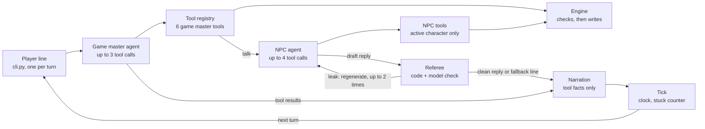

# Harbor Mystery: project structure

Snapshot of the planning doc, 14 Nov 2026. The specification is `BRIEF.md`; accepted decisions are in `adr/001-brief-clarifications.md`.

## At a glance

Harbor Mystery is a terminal detective game built as four layers, where only the bottom layer may change game state.

| Layer | What it is | Lives in |
| --- | --- | --- |
| Interface | The CLI loop that reads one player line per turn and prints the narration | `cli.py` |
| Agents | The game master and NPC loops: they call the model and pick tools, and never touch the database | `agents/`, `llm/`, `prompts/` |
| Tools | Plain Python functions with JSON schemas, the only door into the engine | `tools/`, `referee.py` |
| Engine | Rules, state and the event log in one SQLite file per run | `engine/` |

Tracing (`tracing.py`) cuts across all four: every model call, tool call and referee check is recorded as a span.

The one rule that shapes everything: the model proposes, the engine decides. Agents can only ask for things through tools, and each tool validates in code before changing anything.

## Repo layout

The top-level folders are fixed by the brief; the file split inside `src/harbor/` is a proposal.

```
text-rpg/
├── pyproject.toml            package, pytest config, the `harbor` command
├── README.md                 architecture notes + demo transcript (M6)
├── cases/
│   └── saltmere.json         the seed case: places, characters, clues, solution
├── docs/
│   ├── BRIEF.md              the specification
│   ├── STRUCTURE.md          this file
│   ├── IDEAS.md              anything out of scope goes here
│   └── adr/                  NNN-title.md, half a page each
├── src/harbor/
│   ├── cli.py                argparse entry point and the turn loop
│   ├── engine/
│   │   ├── schema.py         CREATE TABLE statements
│   │   ├── case_loader.py    saltmere.json -> validated case -> case tables
│   │   ├── state.py          read and change game_state, clock, trust
│   │   ├── events.py         append-only event log, replay, state hash
│   │   ├── rules.py          validation: exits, presence, knowledge, trust, topics
│   │   ├── hints.py          pointer hints, stuck nudge, hint target
│   │   └── scoring.py        accuse: scored against case_solution
│   ├── tools/
│   │   ├── registry.py       name -> function + JSON schema; wraps each call in a span
│   │   ├── gm_tools.py       look, go, talk, notebook, hint, accuse
│   │   └── npc_tools.py      recall_knowledge, recall_conversation, reveal_clue, update_trust
│   ├── agents/
│   │   ├── loop.py           the shared hand-written agent loop with a tool-call cap
│   │   ├── game_master.py    at most 3 tool calls per turn
│   │   └── npc.py            at most 4 tool calls per reply
│   ├── referee.py            leak check: code check, then a cheap model check
│   ├── tracing.py            span() helper -> spans table + JSONL
│   ├── llm/
│   │   ├── base.py           LLMClient interface
│   │   ├── scripted.py       ScriptedLLM, deterministic, for tests
│   │   └── hosted.py         HostedLLM, Anthropic Messages API
│   ├── prompts/              game_master.md, npc.md, referee.md
│   └── bot.py                scripted bot player
├── tests/                    offline by default; `pytest -m live` for model checks
├── traces/                   <run_id>.jsonl, plus 5-10 saved examples
└── (M7) .claude-plugin/, mcp_server.py, commands/, agents/
```

Run databases (`runs/<run_id>.sqlite`) stay out of git.

## Modules

Each module has one job and one hard limit; the limits are what make the architecture checkable in tests.

| Module | Owns | Must never |
| --- | --- | --- |
| `engine` | The SQLite file, the rules, the clock, trust, the event log, scoring | Call a model or import from `agents` |
| `tools` | The registry and the 10 tool functions; turns engine results into JSON, errors as `{"ok": false, "error": ...}` | Raise exceptions to the agent, or accept a character ID on NPC tools |
| `agents` | The loop: send messages to the model, run the tool calls it asks for, stop at the cap | Read or write the database directly, or see `case_solution` |
| `referee` | Checking an NPC reply against that character's knowledge; reject, regenerate up to 2 times, then a fallback line | Change game state |
| `llm` | One interface, two implementations (`ScriptedLLM`, `HostedLLM`) | Know anything about the game |
| `tracing` | The `span()` helper writing the `spans` table and the JSONL mirror | Be bypassed: no model or tool call happens outside a span |
| `cli` | Arguments, creating a run, the turn loop, printing | Contain game rules |
| `prompts` | The three prompt files; their hash is stored on each run | Hold facts about the case |

Imports run one way: `cli` -> `agents` -> `tools` -> `engine`. The single exception is the `talk` tool, which starts the NPC agent; it receives the NPC runner as an argument so `tools` does not import `agents`.

**The active-character rule lives in two places.** `talk(character)` writes `active_character` into `game_state`, and the NPC tools read it from there. The NPC model has no argument through which it could name another character.

## How one turn flows

One line typed by the player travels through the modules and comes back as narration; the engine is the only box that writes to the database.



`tracing.span()` records every model call, tool call and referee check above.

1. `cli.py` reads the line and hands it to the game master with a short state summary (place, time, notebook titles).
2. The game master asks for up to 3 tools through the registry. For `look`, `go`, `notebook`, `hint` and `accuse`, the engine validates, changes state, logs an event and returns JSON.
3. For `talk`, the tool checks the character is present, sets them as the active character and starts the NPC agent.
4. The NPC agent makes up to 4 tool calls. Its tools act on the active character only, so it cannot fetch another character's knowledge.
5. The NPC's draft reply goes to the referee. A leak is rejected and regenerated up to 2 times, then replaced by a fixed in-character fallback line.
6. The game master narrates using only what the tools returned this turn.
7. The tick advances the clock and the stuck counter; after 8 turns without a new clue, the engine marks the next clue for a nudge.

## Worked examples

Each example shows what the player types, the spans the turn produces, and what the engine does at each tool call. Indentation in a trace is the parent-child link between spans; `llm` lines show what the model asked for. Wording of replies is illustrative.

### 1. Looking around

The player types `look around` at 06:00 on the Harbor Quay. One tool call, and clue C1 lands in the notebook because it is visible at this place.

```
turn 1                                   kind        status
agent game_master                        agent       ok
├─ llm  "look around" + state summary    llm_call    ok   -> asks for look()
├─ look()                                tool_call   ok
│    engine: read place, characters present, clues with found_at_place = quay
│    engine: C1 not in notebook -> insert notebook row, event clue_found(C1)
│    engine: clock 06:00 -> 06:05, event clock_advanced
│    returns {ok: true, place: "Harbor Quay", description: "...",
│             present: ["Mira Tolle"], clues: [{id: "C1", text: "The winch cable was cut clean..."}],
│             exits: ["Harbormaster's Office", "Fish Market", "Chandlery"], clock: "06:05"}
├─ llm  tool result                      llm_call    ok   -> narration text
└─ end_turn()                            tool_call   ok
     engine: new clue this turn -> turns_since_new_clue = 0
```

**Handling.** The game master's narration may only restate what `look` returned. The time cost is applied inside the tool, not by the agent. `end_turn` is an engine step that the loop always runs last; it is recorded as a `tool_call` span so the brief's rule (no state change outside a tool call) holds for the stuck counter too. It is left out of the later traces unless it does something.

### 2. Going to a place

The player types `go to the lighthouse` while on the Quay. The Lighthouse connects only to the Chandlery, so the first call fails as a value and the model recovers.

```
turn 2
agent game_master
├─ llm  "go to the lighthouse"           llm_call    ok     -> asks for go(place: "lighthouse")
├─ go(place: "lighthouse")               tool_call   error
│    engine: no exits row quay -> lighthouse
│    engine: nothing written, clock unchanged, no event
│    returns {ok: false, error: "no exit from Harbor Quay to Lighthouse",
│             exits: ["Harbormaster's Office", "Fish Market", "Chandlery"]}
└─ llm  tool result                      llm_call    ok     -> "You can't reach the Lighthouse from here.
                                                               The Chandlery lies that way."
```

The player then types `go to the chandlery`, which succeeds:

```
turn 3
agent game_master
├─ llm  "go to the chandlery"            llm_call    ok     -> asks for go(place: "chandlery")
├─ go(place: "chandlery")                tool_call   ok
│    engine: exits row quay -> chandlery exists
│    engine: game_state.place = chandlery, active_character = NULL, event player_moved
│    engine: clock 06:05 -> 06:15, event clock_advanced
│    returns {ok: true, place: "Chandlery", present: ["Ysolde Crane"], clock: "06:15"}
└─ llm  tool result                      llm_call    ok     -> narration text
```

**Handling.** A failed tool call never raises; the model reads the error and the list of real exits and answers from them. The game master could chain `go` twice in one turn (it has 3 calls), but only when the player asks for it. Moving clears the active character, so an NPC tool can never act on someone the player has walked away from.

### 3. Talking to an NPC (clue unlocked by topic)

Back on the Quay at 06:25, the player types `ask Mira if she saw anyone on the quay last night`. This is the full chain: the `talk` tool starts a second agent inside itself, and that agent's reply passes the referee before `talk` returns.

```
turn 4
agent game_master
├─ llm  player line                              llm_call   ok  -> asks for talk(character: "mira",
│                                                                  message: "did you see anyone on the quay last night?")
├─ talk(character: "mira", message: ...)         tool_call  ok
│    engine: Mira is at the player's place -> ok
│    engine: game_state.active_character = mira, event talk_started
│    engine: match message against Mira's unlock topics -> "night", "quay" hit C3
│    engine: store player line in conversations
│    │
│    ├─ agent npc:mira                           agent      ok
│    │   ├─ llm  persona + player message         llm_call   ok  -> asks for recall_knowledge()
│    │   ├─ recall_knowledge()                    tool_call  ok
│    │   │    engine: knowledge rows WHERE character = active (mira),
│    │   │            topic matched, min_trust <= Mira's trust (0)
│    │   │    returns {ok: true, clues: [{id: "C3", text: "A figure with a limp and a lantern..."}],
│    │   │             pointers: [{clue: "C4", ask: "Bram Oyle", line: "the lighthouse sees the water"}]}
│    │   ├─ llm  tool result                      llm_call   ok  -> asks for reveal_clue(clue_id: "C3")
│    │   ├─ reveal_clue(clue_id: "C3")            tool_call  ok
│    │   │    engine: C3 exists, Mira knows it, trust ok
│    │   │    engine: insert notebook row (source mira), event clue_found(C3)
│    │   │    returns {ok: true, id: "C3", text: "..."}
│    │   └─ llm  tool result                      llm_call   ok  -> draft reply in Mira's voice
│    │
│    ├─ referee                                   referee    ok
│    │   ├─ code check: reply matches C3 keywords; C3 was revealed this turn by mira -> pass
│    │   └─ llm  stray-fact check                 llm_call   ok  -> "no leak"
│    │
│    engine: store Mira's reply in conversations
│    engine: clock 06:25 -> 06:35
│    returns {ok: true, character: "Mira Tolle", reply: "Couldn't sleep, so I was out with the nets...
│             someone limping, with a lantern, heading for the fish market. Near two.
│             Ask Bram, the lighthouse sees the water.", new_clues: ["C3"]}
└─ llm  tool result                              llm_call   ok  -> narration, quoting Mira
```

**Handling.**

- The NPC agent's tools have no character argument. `recall_knowledge()` returns Mira's rows because the engine looks up `active_character`, so the model cannot ask for Tom's or Ysolde's knowledge.
- Saying a clue is not the same as revealing it. Only `reveal_clue` writes to the notebook, and the referee checks that any clue the reply mentions went through it.
- The pointer to Bram is chosen by the engine (it is a `pointers` row); the model only phrases it.
- The game master sees just the final `talk` result, never Mira's knowledge or the NPC agent's messages.

### 4. A guarded clue and trust

C5 (the bolt cutters) needs trust 1 with Ysolde. At the Chandlery the player types `who has bought bolt cutters from you lately?` and gets nothing, even though the model tries to reveal it.

```
turn 7
agent game_master
├─ llm                                          llm_call   ok     -> asks for talk(character: "ysolde", message: ...)
├─ talk(character: "ysolde", ...)               tool_call  ok
│    engine: present -> ok; active_character = ysolde
│    ├─ agent npc:ysolde
│    │   ├─ llm                                  llm_call   ok     -> asks for recall_knowledge()
│    │   ├─ recall_knowledge()                   tool_call  ok
│    │   │    engine: Ysolde knows C5 but min_trust 1 > trust 0 -> withheld
│    │   │    returns {ok: true, clues: [], pointers: [], guarded: true}
│    │   ├─ llm                                  llm_call   ok     -> asks for reveal_clue(clue_id: "C5")
│    │   ├─ reveal_clue(clue_id: "C5")           tool_call  error
│    │   │    engine: trust 0 < min_trust 1 -> refused, nothing written
│    │   │    returns {ok: false, error: "trust too low"}
│    │   └─ llm                                  llm_call   ok     -> "I don't discuss my customers' purchases."
│    ├─ referee                                  referee    ok     (no clue content in the reply)
│    returns {ok: true, reply: "I don't discuss my customers' purchases.", new_clues: []}
└─ llm                                          llm_call   ok     -> narration
```

The player asks again, politely: `I understand. Please, it matters for the whole harbor.`

```
turn 8
agent game_master
├─ llm                                          llm_call   ok     -> asks for talk(character: "ysolde", message: ...)
├─ talk(character: "ysolde", ...)               tool_call  ok
│    ├─ agent npc:ysolde
│    │   ├─ llm                                  llm_call   ok     -> asks for update_trust(reason: "polite_repeat")
│    │   ├─ update_trust(reason: "polite_repeat") tool_call  ok
│    │   │    engine: conversations shows an earlier ask to Ysolde today -> allowed
│    │   │    engine: trust(ysolde) 0 -> 1 (one step at most), event trust_changed
│    │   │    returns {ok: true, trust: 1}
│    │   ├─ recall_knowledge()                   tool_call  ok     -> returns C5
│    │   ├─ reveal_clue(clue_id: "C5")           tool_call  ok
│    │   │    engine: trust 1 >= 1 -> notebook row (source ysolde), event clue_found(C5)
│    │   └─ llm                                  llm_call   ok     -> "Tom Brask. Two days ago. He paid in fish."
│    ├─ referee                                  referee    ok     (C5 revealed this turn -> pass)
│    returns {ok: true, reply: "...", new_clues: ["C5"]}
└─ llm                                          llm_call   ok     -> narration
```

**Handling.**

- The model only names a reason for `update_trust`; the engine decides whether trust moves. A `polite_repeat` with no earlier ask in `conversations` is refused, and `rude` lowers trust by one.
- The other route is showing a clue. If the player says `the cable was cut clean, look`, the engine sees C1 is in the notebook and referenced in the message, and accepts `related_clue_shown`.
- Turn 8 uses 3 of the NPC agent's 4 tool calls. A fifth call ends the loop with Ysolde's fallback line.

### 5. The referee catching a leak

In the Harbormaster's Office the player types `who do you think did it?`. Odrin knows C1, C2 and C7 only, but the model drafts a reply that states C5, which belongs to Ysolde.

```
turn 10
agent game_master
├─ llm                                          llm_call   ok        -> asks for talk(character: "odrin", message: ...)
├─ talk(character: "odrin", ...)                tool_call  ok
│    ├─ agent npc:odrin  (attempt 1)             agent      rejected
│    │   ├─ recall_knowledge()                   tool_call  ok        -> pointers to Mira and Hale; no clue matched
│    │   └─ llm                                  llm_call   ok        -> "Brask, I'd wager. He bought bolt cutters
│    │                                                                    from Ysolde two days back."
│    ├─ referee  (attempt 1)                     referee    rejected
│    │   └─ code check: reply matches C5 keywords ("bolt cutters", "Ysolde");
│    │      odrin has no knowledge row for C5 -> leak, model check skipped
│    │
│    ├─ agent npc:odrin  (attempt 2)             agent      ok
│    │   └─ llm  + note "your last reply used    llm_call   ok        -> "I've my suspicions, but I'll not name a man
│    │           facts you do not know"                                   on a guess. Mira's up all hours. Ask her."
│    ├─ referee  (attempt 2)                     referee    ok
│    │   ├─ code check: no clue keywords -> pass
│    │   └─ llm  stray-fact check                llm_call   ok        -> "no leak"
│    engine: store only the accepted reply in conversations; clock +10
│    returns {ok: true, reply: "I've my suspicions...", new_clues: []}
└─ llm                                          llm_call   ok        -> narration
```

**Handling.**

- The raw rejected draft is saved in its span with status `rejected`, so leaks can be counted later. It never reaches the game master or the player, and it is not stored in `conversations`.
- The code check runs first because it is free. The model check runs only on replies that pass it, and catches invented facts the keywords miss.
- Two regenerations are allowed. If the third draft also leaks, `talk` returns Odrin's fixed fallback line from the case file.
- The leaked sentence wrote nothing: C5 is not in the notebook, because only `reveal_clue` can put it there and that call would have been refused for Odrin.

### 6. Notebook, hint and the stuck nudge

**Notebook.** The player types `what do I know so far?`. This is a read: no state change, no time cost.

```
agent game_master
├─ llm                       llm_call   ok  -> asks for notebook()
├─ notebook()                tool_call  ok
│    returns {ok: true, clues: [{id: "C1", text: "...", source: "seen", place: "Harbor Quay", at: "06:05"},
│                              {id: "C3", text: "...", source: "Mira Tolle", place: "Harbor Quay", at: "06:35"}]}
└─ llm                       llm_call   ok  -> narration listing the two clues
```

**Hint.** The player types `hint`. The engine picks the target; the model only phrases it.

```
agent game_master
├─ llm                       llm_call   ok  -> asks for hint()
├─ hint()                    tool_call  ok
│    engine: first unfound clue in nudge order (C2, C3, C4, C5, C6) -> C2
│    engine: who knows C2 and has not been spoken to -> Odrin, at the Harbormaster's Office
│    engine: clock +20 min, event hint_used
│    returns {ok: true, target: {character: "Odrin Vale", place: "Harbormaster's Office"}}
└─ llm                       llm_call   ok  -> "The harbormaster has had the whole village through his door..."
```

The result names a person and place, never the clue's text, so a hint cannot hand over evidence.

**Stuck nudge.** The player wanders for 8 turns without a new clue. Nothing is asked for; `end_turn` arms the nudge and the next conversation delivers it.

```
turn 19  end_turn()          tool_call  ok
     engine: turns_since_new_clue 7 -> 8 -> mark next unfound clue (C4) nudgeable, event nudge_armed

turn 20  player: "go to the lighthouse", then turn 21: "talk to Bram" ("quiet morning?")
agent game_master
├─ talk(character: "bram", ...)                 tool_call  ok
│    engine: C4 is nudgeable and Bram knows it -> unlock it regardless of topic
│    ├─ agent npc:bram
│    │   ├─ recall_knowledge()                   tool_call  ok  -> returns C4 with nudge: true
│    │   ├─ reveal_clue(clue_id: "C4")           tool_call  ok  -> notebook row, event clue_found(C4)
│    │   └─ llm                                  llm_call   ok  -> "Quiet now. Not last night. A skiff, no light on her..."
│    ├─ referee                                  referee    ok
└─ end_turn()                                   tool_call  ok  -> turns_since_new_clue = 0, nudge cleared
```

If the character in front of the player does not know the nudged clue, `recall_knowledge` returns that character's pointer for it, and they send the player on. The nudge never bypasses `min_trust`: a guarded clue such as C5 is nudged as a pointer toward Ysolde, not handed over.

### 7. Accusing

The player types `I accuse Tom Brask. He wanted to keep his monopoly. Mira saw him limping on the quay and Ysolde sold him the cutters.` The game master maps the sentence to notebook clue IDs; the engine scores it.

```
turn 24
agent game_master
├─ llm  player line + notebook titles     llm_call   ok  -> asks for accuse(character: "tom",
│                                                           motive: "keep his monopoly", clue_ids: ["C3", "C5"])
├─ accuse(character, motive, clue_ids)    tool_call  ok
│    engine: every clue_id exists and is in the notebook -> ok
│    engine: culprit matches case_solution.culprit_id -> yes
│    engine: clue_ids in required_clue_ids -> C3, C5 = 2 correct -> result "win"
│    engine: game_state.status = ended, event game_ended
│    returns {ok: true, result: "win", culprit_correct: true, supporting: ["C3", "C5"],
│             missed: ["C2", "C4", "C6"], true_timeline: ["00:00 Tom leaves the tavern", ...]}
└─ llm  tool result                       llm_call   ok  -> ending narration + timeline
```

| Accusation | Engine result |
| --- | --- |
| Tom, with 2 or more of C2 to C6 from the notebook | `win` |
| Tom, with 0 or 1 of them | `partial` |
| Anyone else | `lose` |
| A clue ID that does not exist or is not in the notebook | `{ok: false, error: ...}`; the game does not end and the player can try again |
| No accusation by 18:00 | `end_turn` sets status `ended` with result `timeout` and returns the true timeline |

**Handling.**

- This is the only moment `case_solution` is read, and it is read by `scoring.py`, not by an agent. The true timeline reaches the model only inside this tool result, after the game is over.
- Clues the player names but never found do not count, so the game master cannot win the case by guessing IDs.
- After `status = ended`, every tool returns `{ok: false, error: "game over"}`.
- The `motive` text is recorded and the real motive is shown in the ending; it does not affect the result.

## Data

Each game is one SQLite file holding three groups of tables: case data that never changes after loading, run data that changes only inside tool calls, and trace data.

| Group | Tables | Written by | Read by |
| --- | --- | --- | --- |
| Case (read-only) | `places`, `exits`, `characters`, `clues`, `knowledge`, `pointers` | `case_loader` once, at run start | Engine rules and tools |
| Case, hidden | `case_solution` | `case_loader` once | `scoring.py` only; no agent ever sees it |
| Run (changes) | `game_state`, `trust`, `notebook`, `conversations`, `events`, `runs` | Tool calls, through the engine | Tools, replay, tests |
| Trace | `spans`, `labels` | `tracing.span()` | You, for error analysis |

- **`events` is the source of truth for a run.** Every state change appends one row. Replaying the events from a fresh case load must give the same state hash, which is the determinism test.
- **`knowledge` is the isolation boundary.** A row means "this character knows this clue, unlocked by this topic at this trust". `recall_knowledge` and `reveal_clue` only ever query rows for the active character.
- **`spans` is mirrored to `traces/<run_id>.jsonl`** so a trace can be read without opening the database.

Column lists are in the brief's data model table.

## Tests

One test file per acceptance check in the brief, all offline through `ScriptedLLM` except the live smoke test.

| Test file | Checks | Milestone |
| --- | --- | --- |
| `test_case_loader.py` | `saltmere.json` loads; every reference points at a real place, character or clue | M0 |
| `test_engine_tools.py` | Bad exits, absent characters, unknown clue IDs and low trust each return an error value and change no state | M1, grows to M5 |
| `test_tracing.py` | Every turn has agent, tool_call, llm_call and referee spans with parents; no state change outside a tool_call | M2 |
| `test_isolation.py` | For each character, a scripted reply leaking a clue they do not know is rejected by the referee and refused by `reveal_clue` | M3, M4 |
| `test_hints.py` | After 8 stalled turns a nudge arrives in the stuck-nudge order; pointer hints name a character who really knows the clue | M4 |
| `test_case_solver.py` | Every clue needed for a win is reachable from the start; the clues point to exactly one culprit | M5 |
| `test_bot_player.py` | The scripted bot wins in under 40 turns with at least 2 correct clues | M5 |
| `test_replay.py` | Two runs with one seed, and a replay from the log, give the same state hash | M5 |
| `test_live_smoke.py` | 10 turns with the hosted model; reports time to first words and the referee leak rate | M3, `pytest -m live` |

## Milestones

| Milestone | Claude builds | You write |
| --- | --- | --- |
| M0 scaffold | `pyproject.toml`, package folders, `case_loader.py`, a baseline `saltmere.json` | Polishing `saltmere.json`: descriptions, personas, speech styles, fallback lines |
| M1 engine core | `schema.py`, `state.py`, `events.py`, `rules.py`, `registry.py`, `look` / `go` / `notebook`, plain `cli.py`, tests | ADR on event log versus mutable state |
| M2 tracing + model interface | `tracing.py`, `llm/base.py`, `llm/scripted.py`, spans around every tool | ADR on the tool registry |
| M3 agents | `agents/loop.py`, `npc.py`, `game_master.py`, `talk`, NPC tools, `llm/hosted.py` | The three prompt files; `HARBOR_MODEL` and `ANTHROPIC_API_KEY`; the live smoke test with Mira; ADR on the active-character rule |
| M4 referee + hints | `referee.py`, `hints.py`, the `hint` tool | ADR on the referee design |
| M5 ending + bot | `scoring.py`, `accuse`, `bot.py`, solver, replay test | The bot's walkthrough: the ordered commands that solve the case |
| M6 release | README structure, trace saving, tag `v0.1.0` | Playing a full game for the demo transcript; README prose; choosing 5-10 traces |
| M7 plugin | `mcp_server.py`, plugin and marketplace files, subagent files, `/harbor-mystery` | The install test from the local marketplace |

M0 to M6 give a shippable standalone game. M7 is the brief's own first cut if time runs short.
